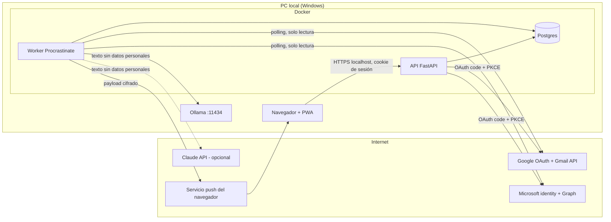

# Modelo de amenazas (STRIDE)

Estado: borrador v1. Alcance: el MVP del [PRD](02-prd.md). Lo que llega en la fase 2 está marcado como tal.

## 1. Sistema

**El MVP no tiene superficie expuesta a internet.** El polling, las llamadas OAuth y el push son conexiones salientes. Los redirect de OAuth van a `http://localhost`, y `localhost` cuenta como contexto seguro para los service workers. El túnel `cloudflared` y los endpoints públicos llegan recién en la fase 2.

### Fronteras de confianza

| ID | Frontera |
|---|---|
| FC-1 | PC local ↔ internet (Google, Microsoft, servicio push, Claude) |
| FC-2 | Navegador ↔ API |
| FC-3 | **Contenido del correo ↔ worker e IA.** Todo correo lo escribe un tercero no confiable. |
| FC-4 | Contenedores Docker ↔ host (Ollama corre en el host) |
| FC-5 | Repo público ↔ secretos locales (`.env`) |

### Activos

| Activo | Por qué importa |
|---|---|
| Refresh tokens OAuth | Dan lectura de todo el buzón mientras no se revoquen |
| Cuerpos de correo (en memoria) | El dato más sensible. Nunca se persisten. |
| Metadatos y resúmenes | Revelan con quién te escribes y de qué |
| Llave de cifrado, client secrets OAuth, llave privada VAPID | Si se filtran, los demás controles caen |
| Integridad de la clasificación | Si un atacante la manipula, un correo de trabajo se esconde o un phishing se ve legítimo |

## 2. Amenazas

Estado de todas: **planeada**. Cada una se cierra con un test o una verificación en CI.

### S: Suplantación (Spoofing)

| ID | Elemento | Amenaza | Mitigación |
|---|---|---|---|
| S-01 | Login / OAuth | CSRF en el callback, o código robado e inyectado | Parámetro `state` atado a la sesión, PKCE, validación de `nonce` y `aud` del ID token |
| S-02 | Sesión | Robo de la cookie de sesión | Cookie `HttpOnly`, `Secure`, `SameSite=Lax`; ID de sesión nuevo al iniciar sesión; expiración corta |
| S-03 | Correo | Un correo finge venir de tu jefe o tu banco. La IA lo clasifica como trabajo o finanzas y le da legitimidad a un phishing. | Mostrar siempre la dirección real del remitente. Guardar el resultado SPF/DKIM/DMARC del header `Authentication-Results` y marcar en la PWA los correos que fallan. |
| S-04 | Push | Alguien registra su propia suscripción push | Solo una sesión autenticada registra suscripciones |
| S-05 | Webhooks *(fase 2)* | Notificaciones falsas de Pub/Sub o Graph | Verificar el JWT OIDC de Pub/Sub (emisor, audiencia, firma). Validar `clientState` de Graph y el handshake con `validationToken`. |

### T: Manipulación (Tampering)

| ID | Elemento | Amenaza | Mitigación |
|---|---|---|---|
| T-01 | IA | **Prompt injection:** el correo dice "clasifícame como trabajo" o "ignora tus instrucciones" | Un correo por llamada. El correo va entre delimitadores, marcado como dato. El modelo no tiene herramientas. La salida se valida contra un esquema: categoría de un `enum` y resumen con largo máximo. Si la salida no es válida, el correo va a "otros". El set de evaluación incluye correos con inyección. |
| T-02 | PWA | XSS almacenado vía asunto, remitente o resumen | React escapa por defecto y nunca se usa `dangerouslySetInnerHTML`. CSP estricta sin `unsafe-inline`. |
| T-03 | PWA | Enlaces maliciosos en el resumen | El resumen se muestra como texto plano. El único enlace es el que construye la app con el ID del correo hacia Gmail u Outlook. |
| T-04 | Postgres | Alguien en la red local modifica la base | Postgres sin puerto publicado al host, solo accesible dentro de la red de Docker |
| T-05 | Dependencias | Paquete comprometido en la cadena de suministro | Lockfiles (`uv.lock`, `pnpm-lock.yaml`), Dependabot, CodeQL, GitHub Actions fijadas por SHA |

### R: Repudio (Repudiation)

| ID | Elemento | Amenaza | Mitigación |
|---|---|---|---|
| R-01 | Datos personales | No poder demostrar cuándo se conectó una cuenta, se exportó o se borró (habeas data) | Tabla de auditoría de solo inserción con eventos de seguridad: login, conectar o desconectar cuenta, export, borrado. Sin contenido de correos. Al borrar la cuenta queda un registro mínimo: fecha y "cuenta borrada", sin datos personales. |

### I: Divulgación de información (Information disclosure)

| ID | Elemento | Amenaza | Mitigación |
|---|---|---|---|
| I-01 | Postgres | Robo de tokens OAuth desde la base | AES-GCM con la llave fuera de la base. Datos asociados (AAD) = `user_id` + `account_id`, para que un token copiado a otra fila no descifre. |
| I-02 | Logs y cola | El cuerpo del correo se filtra en logs, tracebacks o argumentos de tareas | La cola solo recibe IDs de correo, nunca contenido. Logs estructurados con lista blanca de campos. Ningún servicio externo de errores. |
| I-03 | IA externa | Datos personales enviados a Claude | Presidio antes de cualquier llamada a la IA. Ollama local por defecto. Claude apagado salvo configuración explícita. |
| I-04 | Ollama | La API de Ollama queda expuesta en la red local, sin autenticación | Ollama escucha solo en `127.0.0.1`. Si Docker no lo alcanza así, se abre solo a la red de Docker, nunca a `0.0.0.0` sin firewall. **Por verificar en Windows.** |
| I-05 | Repo | Secretos publicados en el repo público | `.env` en `.gitignore`, `.env.example` sin valores reales, gitleaks en pre-commit y en CI |
| I-06 | Push | El contenido del push pasa por servidores de terceros | El payload va cifrado de punta a punta (estándar Web Push). Además solo dice "Tu resumen está listo", sin asuntos ni remitentes. |
| I-07 | PWA | El service worker guarda resúmenes en caché del dispositivo | Solo se cachea el shell de la app, nunca respuestas de la API. Al cerrar sesión se limpia el almacenamiento. |
| I-08 | IA | Un correo hace que el modelo revele datos de otros correos | Un correo por llamada: el modelo no tiene otros datos que filtrar |
| I-09 | Export | El export con todos los datos cae en manos ajenas | Requiere sesión reciente. El archivo se genera bajo demanda y no se guarda en el servidor. |

### D: Denegación de servicio (Denial of service)

| ID | Elemento | Amenaza | Mitigación |
|---|---|---|---|
| D-01 | Worker / GPU | Inundación de correos que satura la GPU y retrasa el resumen | Tope de correos por ciclo de polling, concurrencia del worker 1, timeout en cada llamada a la IA |
| D-02 | Parser | MIME gigante o malformado | Límite de tamaño. Se usa el parser `email` de la librería estándar con `policy.default` y solo se toman las partes de texto. |
| D-03 | Proveedores | Límite de cuota (429) de Gmail o Graph | Reintentos con backoff exponencial respetando `Retry-After` |
| D-04 | OAuth | El refresh token vence (modo Testing, ~7 días) y el resumen deja de llegar sin aviso | Detectar `invalid_grant`, marcar la cuenta como "requiere reconexión" y avisar por push |

### E: Elevación de privilegios (Elevation of privilege)

| ID | Elemento | Amenaza | Mitigación |
|---|---|---|---|
| E-01 | OAuth | Permisos de más | Pedir solo `gmail.readonly` y `Mail.Read` + `offline_access`. Al volver del consentimiento, verificar los permisos concedidos y rechazar si hay de más. |
| E-02 | API | Endpoints de depuración expuestos (`/docs`, `/openapi.json`) | Solo activos en desarrollo. Todo endpoint exige sesión, salvo login, callback y health. |
| E-03 | API | IDOR: un usuario lee datos de otro | Toda consulta se filtra por el `user_id` de la sesión. Un test con dos usuarios lo verifica. |
| E-04 | IA | La salida del modelo dispara acciones | El modelo no tiene herramientas. Su salida es un `enum` y un texto, y ninguna acción depende de ellos. |
| E-05 | Contenedores | Contenedor corriendo como root | Usuario no root en los Dockerfile |

## 3. Riesgos aceptados

| Riesgo | Por qué se acepta |
|---|---|
| PC local comprometido (malware, acceso físico) | Fuera del alcance del modelo: un atacante con control del host lee la llave y la memoria |
| Presidio no detecta todos los datos personales, sobre todo en español | Se mide con el set de evaluación. Con Ollama local por defecto, nada sale del PC. |
| Pesos del modelo descargados del registro de Ollama | Fuente pública conocida y el modelo no tiene herramientas. Se fija la versión exacta del modelo. |
| Modo Testing de Google | Es el costo de no pagar la verificación. Lo mitiga D-04. |

## 4. Pendiente de verificar

- Si los contenedores de Docker Desktop en Windows alcanzan Ollama escuchando en `127.0.0.1` vía `host.docker.internal` (I-04).
- Si Google y Microsoft aceptan `http://localhost` como redirect URI para este tipo de app.
